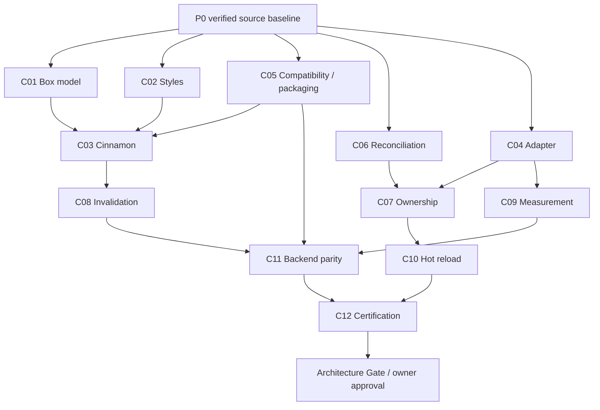

# P0.5 — Velto Architectural Contract Deltas C01–C12

**Version:** 0.1.0 · **Date:** 2026-10-18 · **Status:** PROPOSED — NOT RATIFIED  
**Owner approval required:** Yes, for new semantics and supersessions  
**Authoring scope:** PSX Markup, Cinnamon within PSX, native renderers, Velto facade, Pydux and Qyro boundaries  
**Implementation permission:** NONE (documentation-only proposal)

This is a **delta specification**, not twelve replacements for already approved architecture. Read [existing contract index](CONTRACTS_INDEX.md), [source audit](velto-p0-baseline-audit.md), [verification report](P0_VERIFICATION_REPORT.md), [master plan](velto-master-execution-plan.md) before acting. Terms **MUST / MUST NOT / SHOULD** below are **proposed requirements only**, pending Architecture Gate owner approval. Frozen F1–F4 decisions remain normative independently of this document.

## 0. Source hierarchy, gate, and decision labels

- `FROZEN`: restatement of a previously approved rule; links below indicate source.
- `PROPOSED`: new normative wording needing sign-off; do not implement on this document alone.
- `OPEN`: alternatives or semantics without approval.
- `DEFERRED`: explicitly outside the current milestone; do not advertise.
- `EVIDENCE`: source observed; **not** necessarily a passing runtime test.

Base freeze anchors: [F1 final](sfle-f1-final-architecture.md), [F1 box model](sfle-f1-box-model.md), [F2 certification](sfle-f2-final-certification.md), [F3 implementation](sfle-f3-implementation.md), [F4 Grid](responsive-grid-contract.md), [capability certification policy](capability-certification-policy.md), [M8/F6](../m8-hot-reloading.md).

**Global invariant G-01 (FROZEN + owner direction):** PSX is a **markup** authoring language. Cinnamon is integrated within PSX; it owns pure layout geometry, while renderers perform native measurements and physical widget mutation on the UI thread.

**G-02 (FROZEN + owner direction):** Existing exported components (including `Text`, `Button`, `Flex`, `Grid`) stay available and must be adapted rather than deleted. This does not resurrect removed `Row` or `Column` APIs.

**G-03 (PROPOSED):** Unsupported semantics fail clearly at validation/capability boundaries. Never imitate CSS behavior silently.

**G-04 (PROPOSED):** Every new property must have exactly one canonical normalized meaning across parsing, pure layout, native presentation and introspection; exceptions must have explicit capability entries and tests.

**G-05 (PROPOSED):** A new runtime semantic change requires its acceptance fixtures and intelligent CI routing in the same increment; native lifecycle changes require native retention coverage.

## 1. C01 — Universal Box Model

**State:** PARTIAL · **Authority:** [D-F1.6 / D-F1.7](sfle-f1-box-model.md), [D-F1.13](sfle-f1-final-architecture.md)

**FROZEN:** Preserve content/padding/border/margin semantics, `content-box` vs `border-box`, typed CSS-like length expressions and percentage reference rules; `layout_width`/`layout_height` namespaces preserve component-owned `width`/`height`. A zero intrinsic dimension is not equivalent to `unknown`; margin can be signed; no flex-margin collapse.

**PROPOSED:**
- Each layout participant MUST expose a normalized immutable box snapshot with content, padding, border, margin edges, resolved min/max constraints, declared sizing box, and an explicit unresolved-length state.
- Only one engine is authoritative for each geometry dimension; native toolkit layout MUST NOT subsequently overrule a Cinnamon committed rectangle without an explicit ownership/capability contract.
- Changes in font, content, image intrinsic size or viewport MUST invalidate the affected box/ancestor dependency graph according to C08, not indiscriminately retain stale measurements.
- A renderer MUST report overflow and clipping capability separately from drawing borders; geometry support alone MUST NOT assert painted-border parity.

**OPEN C01-D1:** supported overflow vocabulary (`visible`, `hidden`, `scroll`, `auto`) and `Scroll` bridge; which cases are initially unsupported? **OPEN C01-D2:** default `box-sizing` for new lowercase tags and how it maps to existing components. No implicit change to existing defaults.

**Conformance:** B01 padding percentages use containing inline size; B02 min/max with border-box; B03 signed margin; B04 auto and unresolved sizes; B05 nested scroll clipping; B06 font/image intrinsic changes. Compare logical 1/64px rounding, Rust/Python and native tolerances under existing rules.

**Exit:** owner resolves D1/D2; metadata contracts map to actual source; passing pure/native fixture receipts; compatibility evidence.

## 2. C02 — CSS-like Styling and Property Resolution

**State:** PARTIAL · **Authority:** [F1 closed property partition](sfle-f1-box-model.md), existing component validators

**FROZEN:** Layout-owned `layout_*` metadata MUST NOT be blindly consumed as native component props. Unknown properties use strict validation; `snake_case` is canonical Python/markup spelling in F1. CSS length strings are data, not Python expression evaluation.

**PROPOSED:**
- Define a single deterministic sequence: PSX markup parse → tag/prop resolution → component-owned vs layout-owned partition → typed style normalization → immutable computed snapshot → layout/native updates.
- Property owners MUST be explicit. Native component-specific and portable layout props cannot ambiguously share a name; collisions MUST be diagnosed or handled by an approved compatibility adapter.
- Style snapshot comparison SHOULD use stable immutable values, not repeatedly reparsed strings or persistent duplicate mutable stores.
- Errors MUST name element, offending property, accepted kinds and backend limitation when applicable.

**OPEN C02-D1:** inline style object vs individual props vs stylesheet selectors? **OPEN C02-D2:** cascade, inheritance and specificity (recommend limited/no cascade until a complete rule matrix is approved). **OPEN C02-D3:** pseudostates, paint-only styling and color/font token semantics. **DEFERRED:** browser-complete CSS syntax and arbitrary CSS functions, unless separately approved.

**Conformance:** S01 prop normalization across builder and markup; S02 unsupported value error; S03 precedence and explicit override; S04 style changes dirty only needed passes; S05 no executable interpolation of CSS strings.

## 3. C03 — Cinnamon Layout and Engine Boundaries

**State:** PARTIAL · **Authority:** [F1 final](sfle-f1-final-architecture.md), [F2](sfle-f2-final-certification.md), [F4 Grid](responsive-grid-contract.md)

**FROZEN:** Pure geometry is backend-neutral; fixed-point signed 1/64px and parity semantics; Rust-primary with a documented Python fallback. F4 `Grid` is a **12-column Flexbox-style layout** with `GridItem`, NOT full CSS Grid. `SFLE-CSS-01` transferred aspect-ratio sizing and `SFLE-CSS-02` intrinsic auto-wrap are deferred per [roadmap](../roadmap.md).

**PROPOSED:**
- Each engine request MUST include immutable, versioned constraints and measured intrinsic inputs, with no Qt/Tk/Kivy widget references.
- Engine output MUST identify unresolved/capability errors and authoritative logical rectangles; consumers MUST NOT mutate the result to approximate forbidden CSS behavior.
- The Rust and Python backends MUST accept/reject the same declared supported inputs; parity tests MUST include overflow saturation, percentage cycles, RTL and Grid responsiveness.
- Responsive Grid widths MUST resolve against actual Grid content-box width, not global window width.

**OPEN C03-D1:** whether an explicit block formatting context is in P1 or later (do not infer HTML `div` semantics). **OPEN C03-D2:** committed box-tree schema/version migration.

**Conformance:** L01 fixed-point differential; L02 percentage and min/max; L03 RTL; L04 nested Flex/Grid; L05 12-column responsive thresholds; L06 explicit unsupported full CSS Grid; L07 negative/overflow numerical inputs.

## 4. C04 — Renderer Adapter and Native Lifetime

**State:** PARTIAL · **Authority:** [Renderer protocol](../../psx/renderers/protocol.py), [adapter registry](../../psx/renderers/adapters.py), [native renderer implementations](../../psx/renderers/)

**EVIDENCE:** Renderer base protocol includes `create/update/insert/move/remove/bind_event/unbind_event/destroy/schedule_ui/run`; `commit_layout` and `invalidate_layout` are currently implementation-side optional extensions. Qt uses `deleteLater()` for owned widgets; Tk `destroy()`; Kivy has explicit parent/hint restoration for borrowed widgets. Refer to [P0 audit](velto-p0-baseline-audit.md).

**PROPOSED:**
- The lifecycle state machine MUST distinguish **described**, **created**, **measured**, **attached**, **updated**, **detached**, **disposed**, and **native-release pending** where applicable.
- Each handle MUST have a declared owner (`owned` vs `borrowed`); borrowed native widgets MUST NOT be destroyed and MUST have prior parent/layout hints restored by the backend when supported.
- All native toolkit mutations and measurements MUST run on the owning UI thread; non-UI callers enqueue deterministic work.
- Adapter event bind MUST yield a disposer/unbind token; registrations MUST NOT multiply across reconciliations.
- Failed create/mount MUST trigger safe reverse cleanup of successfully allocated handles.

**OPEN C04-D1:** move measurement/layout invalidation into a versioned optional protocol or retain capability discovery; **do not make a hard breaking signature change without adapter migration tests**. **OPEN C04-D2:** error aggregation policy (joint with C07).

**Conformance:** R01 owned/borrowed; R02 create rollback; R03 remount cleanup; R04 injected adapter errors; R05 no UI-thread violation; R06 custom adapter event unsubscribe.

## 5. C05 — Public Component Compatibility and Lowercase Markup

**State:** CONFLICTING **specifically in distribution/dependency metadata**, not known component behavior · **Authority:** [PSX exported API](../../psx/__init__.py), [F1 D-F1.10](sfle-f1-final-architecture.md), [Velto facade](https://github.com/Neuri-AI/Velto)

**FROZEN:** Existing `Button`, `Text`, `Flex`, `Grid`, etc. remain available; `Row`/`Column` should not be revived by accident. PSX Markup is canonical authoring language, but builder APIs are preserved.

**PROPOSED:**
- Register lowercase HTML-like tags only with an explicit, versioned mapping and collision rules; a lowercase tag MUST NOT claim HTML semantic parity unless independently specified.
- Existing PascalCase tags, documented props/defaults, errors and events MUST remain valid through migration unless owner approves a versioned breaking change.
- Each proposed alias MUST map to a registered component with executable builder/markup parity tests and backend coverage.
- Installed `velto` façade MUST actually resolve compatible `psx`/ `velto-core`, Pydux and Qyro distributions before declaring a supported release.

**OPEN C05-D1:** canonical lowercase vocabulary (e.g., `box`, `text`, `button` vs `div`/`span`); **OPEN C05-D2:** alias/name casing and prop mapping; **OPEN C05-D3:** canonical distribution and version graph (H-PKG-01).

**Conformance:** A01 full existing export census; A02 migration snapshots for currently supported components; A03 lowercase mapping collisions; A04 unsupported HTML elements; A05 clean-wheel dependency resolver and import/install matrix.

## 6. C06 — Reconciliation, Keys and Identity

**State:** PARTIAL · **Authority:** [Reconciler](../../psx/core/reconcile.py), [mounted instance](../../psx/core/instance.py), [hooks](../../psx/core/hooks.py)

**EVIDENCE:** Keyed and unkeyed diffing; `_unmount` disposes events, clears ref and hooks, walks children and calls native destroy. See [P0.3](P0_VERIFICATION_REPORT.md).

**PROPOSED:**
- Identity is based on compatible node/component definition and stable sibling key; moving a keyed item MUST NOT silently reassign another item's hook state.
- Removing a subtree MUST sever event/ref/effect/native ownership even if an unrelated sibling changes simultaneously.
- A stale state setter or event callback after dispose MUST NOT recreate native handles.
- Failure handling MUST define which tree remains authoritative after partial native update and whether a rollback/remount is required.

**OPEN C06-D1:** mixed keyed/unkeyed sibling transitions and diagnostics; **OPEN C06-D2:** fragment/multi-root evolution (existing `MountedInstance.native_handle` requires one effective root); **OPEN C06-D3:** exception-safe unmount strategy delegated to C07.

**Conformance:** K01 keyed reorder; K02 key collision; K03 key replacement/resets; K04 stale callbacks; K05 component-root type changes; K06 fault-injected teardown.

## 7. C07 — Memory and Resource Ownership

**State:** PARTIAL · **Authority:** C04/C06 behavior, [P0 source investigation](velto-p0-baseline-audit.md), [H-MEM-01](P0_VERIFICATION_REPORT.md)

**PROPOSED:**
- Every resource class MUST have a documented creator, owner, detach/dispose operation, and post-unmount observation. Minimum set: mounted VNodes, event subscriptions, hook effects, queued work, borrowed/owned native handles, layout caches, Pydux selectors, async tasks, image resources and hot-reload observers.
- Unmount SHOULD continue independent teardown despite a user callback throwing; report failures **after** all safely disposable resources are attempted (error aggregation policy requires approval).
- No permanent cache SHOULD retain disposed widget/instance keys or unbounded image/geometry history. Define a bounded eviction/epoch strategy for caches with long-lived roots.
- A retained RSS high-water mark alone MUST NOT be classified as a memory leak; native-object counts, Python allocations, event subscriptions and time-to-quiescence are part of the test contract.

**OPEN C07-D1 (high):** owner-approved exception policy for `dispose_hooks`/`_unmount`; **OPEN C07-D2:** cache bounds and test thresholds based on measured baseline; **OPEN C07-D3:** Pydux / coroutine cancellation ownership.

**Conformance:** M01–M07 from P0.3; plus 100–1000 cycle mount/unmount, event-loop drain, image churn, resize churn, selector unsubscribe, failed mount rollback, idle plateau reporting. Never invent a universal 1 GB limit.

## 8. C08 — Invalidation, Scheduling and Resize Reentrancy

**State:** PARTIAL · **Authority:** renderer `commit_layout` / `invalidate_layout` in Qt, Tk, Kivy

**EVIDENCE:** All three native renderers use invalidation epochs/caches; bounded retries for stale semantic epochs; Qt event filters, Tk `after` cancellation and Kivy Clock/Window watchers are present.

**PROPOSED:**
- A layout invalidation MUST contain explicit source (viewport, font, DPI, text, image, style, content) and epoch; superseded work MUST NOT commit stale geometry.
- Resize callbacks MUST be coalesced outside native layout/paint call stacks, with a bounded retry and a deterministic error if perpetual invalidation prevents quiescence.
- A committed rectangle SHOULD only be applied to a native handle when its relevant geometry changed; prevent self-triggering cycles without suppressing genuine resizes.
- Destroy/unmount MUST cancel watchers and pending jobs; callbacks MUST detect stale lifetime/epoch.

**OPEN C08-D1:** shared scheduling contract vs per-backend implementations; **OPEN C08-D2:** canonical retry count as public guarantee or implementation detail.

**Conformance:** I01 rapid viewport drag; I02 measurement invalidated mid-commit; I03 theme/font/DPI updates; I04 teardown during queued resize; I05 stable idle after repeated equal geometry.

## 9. C09 — Native Intrinsic Measurement

**State:** PARTIAL · **Authority:** [F1 native-measurement decisions](sfle-f1-final-architecture.md), [native capabilities](../../psx/sfle/native_component_capabilities.py), Qt/Tk/Kivy layout bridges

**FROZEN:** Measurements occur on UI thread and feed renderer-neutral Cinnamon; no native widget in math request.

**PROPOSED:**
- Invalid Qt `sizeHint()` (negative/unavailable) MUST NOT turn into a fabricated content size. `minimumSizeHint()`, explicit constraints or `ensurePolished()` may be used only with documented component/backend-specific precedence.
- `(0, 0)` is not automatically invalid; intentional zero-sized content must remain representable.
- Width-dependent intrinsic measures (e.g., text height-for-width) MUST use post-layout width where required; content/style/DPI epochs invalidate their caches.
- Kivy controls lacking a certified intrinsic port MUST have explicit required definite dimensions or a capability error, never pretend default `size_hint` is content measurement.

**OPEN C09-D1:** exact fallback sequence by component; **OPEN C09-D2:** measurement cache key schema and handling of asynchronous image metadata.

**Conformance:** N01 unpolished Qt custom QWidget; N02 negative hints/valid zeros; N03 text height-for-width; N04 theme/DPI; N05 image late load; N06 Kivy deficient ports.

## 10. C10 — Intelligent Hot Reload Lifecycle (F6)

**State:** PARTIAL · **Authority:** [M8 implementation limits](../m8-hot-reloading.md)

**FROZEN:** Dev-only watcher/supervised restart exists, with limited compatible component refresh; never promise arbitrary module/native reload. Frozen production builds MUST NOT watch source.

**PROPOSED:**
- Classify each change as `FAST_REFRESH`, `COMPONENT_REMOUNT`, or `PROCESS_RESTART` with a stable developer diagnostic reason; preservation requires compatible component definition, hook order and native lifecycle.
- Only explicitly supported project modules may hot-reload in-process; third-party/native/bootstrap changes restart conservatively.
- Snapshot restore remains opt-in, versioned JSON only; no native handles/closures/credentials/pickle.
- Every restart/remount MUST dispose old observers/subscriptions and avoid parallel native event-loop owners.

**OPEN C10-D1:** exact signature classifier; **OPEN C10-D2:** integration ownership among `velto-dev`, PSX devtools, Qyro CLI/Engine; **OPEN C10-D3:** state migration and revert after syntax errors.

**Conformance:** H01 compatible edit state retained; H02 hook change remount; H03 native module restart; H04 syntax error recovery; H05 100 repeated saves no watcher multiplication; H06 production/frozen disabled.

## 11. C11 — Cross-backend Feature Parity

**State:** UNVERIFIED · **Authority:** [F3 CI](sfle-f3-ci-strategy.md), [F4 certification](capability-certification-policy.md)

**PROPOSED:**
- Publish a per-component feature matrix `backend × Python × OS × property/event/lifecycle` with `supported`, `unsupported explicit error`, or `not tested`. These states MUST NOT be conflated.
- Define common logical geometry fixtures and per-backend native readback tolerances; use accepted F1/F2 thresholds where applicable.
- Native-widget escape hatches MUST remain backend-specific without silently providing fake equivalent controls.
- Every new portable feature SHOULD have native behavioral tests on each claimed backend; headless tests cannot certify native ownership.

**OPEN C11-D1:** exact support commitments of PySide2/Qt families and Kivy platform cells; **OPEN C11-D2:** baseline refresh process and waiver owners.

**Conformance:** P01–P03 Qt/Tk/Kivy mounted/readback suites, P04 settings/breakpoints, P05 native borrowed/owned teardown, P06 packaging matrix, P07 unsupported-cell explicit diagnostics.

## 12. C12 — Testing, Certification and Release Evidence

**State:** PARTIAL · **Authority:** [F4 capability certification](capability-certification-policy.md), [F3 intelligent CI](sfle-f3-ci-strategy.md), [F5.5 docs](f5-5-public-documentation-contract.md)

**FROZEN:** Actual behavior-specific tests, change-impact routing and public-behavior census accompany new capabilities; documentation claims refer to actual source and runnable examples.

**PROPOSED:**
- A closure record MUST bind exact SHA, command/CI URL, OS/backend/Python versions, test counts, failures/skips, native measurement evidence, and known waivers.
- Docs-only commits MUST preserve project-approved selective CI behavior (no costly native jobs solely for Markdown edits).
- New contracts MUST track each acceptance case to a real test path/workflow, with `planned`, `implemented`, `executed_pass`, `executed_fail` or `waived` and a reason.
- Release cannot close with unverified supported cells or contradictory distribution metadata.

**OPEN C12-D1:** minimum supported matrix; **OPEN C12-D2:** performance regression thresholds measured on matched machines; **OPEN C12-D3:** F5.5 G6 owner sign-off/document-status correction.

**Conformance:** Q01 impact selector positive/negative; Q02 full parser/reconciler/layout tests; Q03 native matrix at same SHA; Q04 package/wheel installed examples; Q05 memory soak; Q06 docs reproduction from clean machine.

## 13. Cross-contract dependency / parallel work

**Contract drafting (documentation only) can proceed in parallel** once a clause is mapped to source; **implementation** remains prohibited until applicable critical decisions are owner-approved and the execution baseline is certified.

## 14. Owner decision register (unapproved)

| Decision | Options to adjudicate | Recommended draft direction | Blocked work |
| --- | --- | --- | --- |
| AD-01 (C01) | Broad vs bounded overflow/scroll support | Bounded features and explicit unsupported diagnostics | Box/native clipping |
| AD-02 (C01) | New tag box-sizing default | Preserve old defaults; introduce new default only behind explicit compatibility distinction | Lowercase boxes |
| AD-03 (C02) | Full cascade vs scoped styles | Scoped, deterministic styling first; no unverified CSS claims | Style API |
| AD-04 (C03) | Block formatting context in P1? | Separate approved increment unless pure contract is demonstrated | Block tags |
| AD-05 (C04/C07) | Cleanup fail-fast vs continue-and-report | Continue safe teardown and report deterministic failures | Native resource finalization |
| AD-06 (C05) | Lowercase names and alias policy | Explicit registry with native/portable distinctions | Markup aliases |
| AD-07 (C05) | Package/distribution/version graph | Resolve H-PKG-01 by clean-wheel evidence and owner release policy | Fresh install / facade |
| AD-08 (C06) | Multi-root and keyed transitions | Preserve existing single-root contract pending dedicated RFC | Fragment evolution |
| AD-09 (C08/C09) | Measurement/callback protocol evolution | Versioned optional capability extension before breaking base interface | Renderer bridge |
| AD-10 (C10) | Hot reload classification/state snapshot | Conservative classifier and restart fallback | F6 |
| AD-11 (C11/C12) | Matrix, perf/soak thresholds | Same-machine baselines and explicit excluded cells | Release certification |
| AD-12 (F5.5) | Documentation G6 signoff | Obtain CI + owner evidence, do not silently rewrite status | Documentation closure |

**A recommendation in this table is not an accepted decision.** Agents must log owner decision, date, alternatives considered, superseded clauses, changed API and tests before changing any behavior.

## 15. Definition of ready and implementation blockers

A delta is **READY FOR REVIEW** only when: (1) every requirement is linked to frozen sources or marked PROPOSED; (2) no hidden API removal; (3) positive/negative tests drafted; (4) cross-backend exceptions explicit; (5) references to actual symbols and package names correct; (6) reviewer records unresolved alternatives. It is **APPROVED** only with owner sign-off.

**Current project status:** Proposed C01–C12 written, none newly ratified; `H-PKG-01`, `H-MEM-01`, current executed core/native CI, and AD-01–AD-12 remain unresolved. **Architecture Gate = BLOCKED.** No production changes or public feature shipping are authorized by this file.
