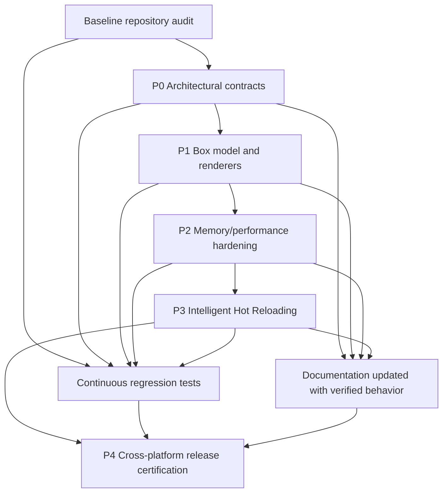

# Velto — Master Execution Plan

> **Version:** 1.0 · **Date:** 2026-10-18 · **Status:** Proposed execution plan / pending codebase verification  
> **Audience:** Implementing agents, reviewing agents, maintainers, documentation agents.  
> **Scope:** Velto, PSX Markup, Cinnamon, renderer adapters, Pydux, Qyro Engine and Qyro CLI where relevant.

## 0. Executive directive

Evolve Velto into a native UI framework with a consistent **web-like box model** and **CSS-like styling semantics**, preserving the existing public component APIs, platform-native widget integration and the established PSX Markup identity. Do not market or describe PSX Markup as inherently *declarative*: it is **markup**, and declarative usage is optional.

Execution priorities, in dependency order:

1. **P0 — Architecture and behavioral contracts**
2. **P1 — Universal box model and renderer integration**
3. **P2 — Memory management, lifetime correctness, and performance**
4. **P3 — Intelligent Hot Reloading (F6)**
5. **P4 — Cross-platform certification and pedagogical documentation**

The above is an **execution order**, not a claim that the work is already implemented or that each item is an existing issue or PR. Validation and regression testing are continuous throughout all priorities, not deferred to P4.

## 1. Current context and evidence rules

### 1.1 Previously reported milestones

Earlier project discussions reported F1 architecture, F2 Cinnamon, F3 Flex, F4 12-column Grid, F5 expressive PSX Markup, and F5.5 public documentation as closed. F6 Hot Reloading was postponed. A newer web-like/CSS-like direction was approved on 2026-10-17, with an internal F0–F8 proposal mentioned but not reproduced here.

**Important:** These are historical project reports, not a fresh repository audit. The implementing agent must verify the actual repository state, tests, branch, interface definitions, and outstanding issues. Do **not** infer that a prior milestone makes a subsystem bug-free or that the new F0–F8 plan has been implemented.

### 1.2 Source-of-truth order

1. Actual code and tests in the local checkout, at a recorded commit SHA.
2. Accepted architecture decisions and contracts in the project repositories.
3. Active implementation plans / issue trackers.
4. Published documentation (may lag code).
5. This coordination plan and earlier conversation history.

If sources conflict, record the conflict and propose a minimal resolution before implementation. Do not silently overwrite a verified contract with a guess.

### 1.3 Mandatory preliminary inventory

Before edits, inspect at minimum:

- `velto` public facade and `velto.ui`, `velto.state`, `velto.runtime` exports.
- PSX parsing/AST, VNode creation, keyed reconciliation, component instances, hooks, and events.
- Cinnamon measurement/layout execution and its integration **inside PSX**.
- Renderer adapters and native widget ownership across PySide6, PyQt6, PyQt5, PySide2 where supported, Tkinter, Kivy.
- Existing `Text`, `Button`, `Input`, `Flex`, `Grid` and other supported components.
- Style handling, unit normalization, layout constraints, native size hints, lifecycle/unmount behavior.
- Pydux subscription ownership and cleanup, Qyro runtime packaging/resolution, Qyro CLI dev workflow where applicable.
- Existing certification scripts, test fixtures, benchmarks and public docs.

Produce `BASELINE.md` with repository paths, commit IDs, supported Python/backend combinations, existing test commands, observed architectural boundaries, known issues and evidence links. Do not invent paths or tests.

## 2. Non-negotiable architecture invariants

**A. Markup identity.** PSX Markup is the public UI language. Preserve its syntax contracts: text literals such as `gap="12"`, expressions inside `{...}`, supported conditionals, `.map()`, callbacks, keys and hooks according to the code verified in the baseline. Do not assume React/JSX semantics where PSX differs.

**B. Cinnamon ownership.** Cinnamon is integrated inside PSX as its layout engine. Avoid presenting it as an independent peer framework or inserting an unnecessary separate public layer.

**C. Preserve existing APIs.** The existing `Button`, `Text`, `Flex`, `Grid`, etc. must be **restructured**, not removed as a shortcut. Lowercase HTML-like tags may become the recommended new syntax, but they must coexist with documented existing components. Any unavoidable breaking change requires an explicit migration ADR and approval.

**D. Consistent semantics, native implementations.** Standardize measurable box-model semantics while allowing Qt, Tkinter and Kivy to retain native implementations. Avoid promising browser CSS completeness or pixel-perfect equivalence across platform text and OS rendering.

**E. Stable keys and cleanup.** Component identity and hook state must follow stable keys; removal must trigger complete unmount and cleanup. Component moves must not leak native handles, event bindings or stale subscriptions.

**F. No unbounded memory retention.** Caches, registries, watchers, callbacks, async tasks and layout caches need clearly defined owners, bounds and release paths.

**G. Test before claiming.** Each change requires unit tests plus integration/regression coverage appropriate to its backend and public API surface.

## 3. Delivery stages and quality gates

### P0 — Define and freeze architectural contracts

**Goal:** Create a precise, implementable contract for the new web-like/CSS-like behavior before touching cross-cutting renderer internals.

**Work packages**

- P0.1: Audit existing style/layout parsing and identify compatibility constraints.
- P0.2: Specify canonical box tree: content, padding, border, margin; content-box vs border-box defaults; minimum/maximum constraints; box sizing; overflow and clipping; intrinsic measurement.
- P0.3: Define property normalization: supported units (`px`, `%`, etc.), unknown property handling, defaults, inheritance (if any), precedence, cascade scope (if any), and invalid values. **Do not assume full CSS cascade or CSS syntax without approving a contract.**
- P0.4: Define block/Flex/Grid layout behavior and precedence among native hints, intrinsic size and explicit constraints.
- P0.5: Define PSX markup mapping for existing PascalCase components and new lowercase aliases; define how property names map across spellings and versions.
- P0.6: Define ownership/lifecycle from VNode through renderer native handle: create → measure → mount → update → layout → unmount → destroy.
- P0.7: Define capability matrix and fallback/error behavior for each renderer.

**Deliverables:** `architecture/box-model-contract.md`, `architecture/style-contract.md`, `architecture/component-compatibility.md`, `architecture/lifecycle-contract.md`, `architecture/renderer-capabilities.md`, and relevant ADRs. Paths are suggested destinations, not asserted current paths.

**Exit gate P0:** Contracts include representative executable or testable examples, edge cases, a written backward compatibility matrix, and review approval. Unresolved semantics are enumerated and blocked rather than guessed.

### P1 — Integrate universal box model end to end

**Goal:** Implement contract P0 in PSX/Cinnamon and every supported renderer in controlled slices.

**CSS Core design track (owner-approved architectural direction, 2026-10-18):** [Universal Box Model and CSS Core Architectural Contract](universal-box-model-and-css-core-contract.md) extends this execution sequence with an internal parser, selector matcher, cascade, computed-style pipeline, incremental invalidation and native capability boundary. The architecture is **approved as direction, not implemented or fully certified**. The contract explicitly preserves existing twelve-column `Grid` / `GridItem` and treats new CSS Grid tracks as a separate future Cinnamon algorithm. Exact public API and capability subsets remain open in that contract; resolve applicable details and global approval gate conditions before production rollout. The six slices remain the execution outline, not sufficient CSS Core acceptance evidence.

**Sequence**

1. Introduce or adapt a single normalized style/box representation; keep backend-specific native attributes inside adapters.
2. Propagate constraints and intrinsic measurement through Cinnamon; implement deterministic box geometry and invalidation.
3. Map existing `Text`, `Button`, `Flex`, `Grid`, and inputs onto the new box model without deleting their public names or breaking known working examples.
4. Add lowercase tag mappings incrementally, with explicit semantics and tests.
5. Implement renderer bridge behavior for Qt, Tkinter and Kivy; use shared conformance fixtures, plus backend-specific tests.
6. Validate update, resize, key reorder, nested scrolling and native-widget embedding.

**Critical native measurement requirements**

- In Qt, `sizeHint()` may be invalid before native initialization; guard negative/invalid values and prefer explicit constraints, `minimumSizeHint()` or carefully scheduled initialization such as `ensurePolished()` where justified. Never treat `(0, 0)` as invalid unconditionally (zero can be intentional); define component-specific fallback rules.
- Avoid resize feedback loops: diff geometry before applying it, coalesce invalidations, separate layout computation from geometry mutation, and guard re-entrancy. Resist solving instability by suppressing all native signals.
- Avoid a second authoritative geometry system. Explain when native layouts are delegated to versus replaced by Cinnamon and avoid fighting both simultaneously.
- Respect thread/UI-loop ownership for native calls.

**Deliverables:** implementation, component compatibility snapshots, geometry fixtures, test suite, migration notes and updated conformance matrix.

**Exit gate P1:** Existing API examples still run; new markup variants produce contract-conformant layouts; no confirmed layout feedback loops in stress cases; no unresolved regressions above the project's accepted severity threshold. Include evidence per backend; do not mark unsupported combinations as passing.

### P2 — Memory, resource ownership and performance

**Goal:** Ensure long-lived apps are stable under interaction and incremental UI updates rather than gradually retaining dead objects.

**Audit matrix**

| Risk area | Required inspection and defense |
| --- | --- |
| VNodes and reconciler | Previous-tree retention, keyed reuse, removal cleanup, cyclic references, fragment/list churn |
| Hooks and effects | Dependency cleanup, cancelled/replaced effects, stale closures, component lifetime |
| Events | Qt signal disconnection, Tk callbacks/bindings, Kivy property/event unbinding |
| Native widgets | Parent-child ownership, `deleteLater()` timing in Qt, renderer handle registry, unmount destruction |
| Pydux | Store subscription unsubscribe on unmount, selector/cache lifetime |
| Async and tasks | Cancellation, late completion after unmount, references to dead native handles |
| Cinnamon | Bounded measurement/layout caches, invalidation keys, stale layout-node release |
| Images and other assets | Decoded image caches, GPU resources, backing buffers and eviction policy |
| Hot reload groundwork | Watchers, module instances, old code references, duplicated callback registration |
| Diagnostics | DevTools observers/log buffering and instrumentation cleanup |

**Metrics and test protocol**

- Record baseline process RSS/USS (where supported), Python allocation profiles (`tracemalloc` where meaningful), native widget counts, live component counts, active tasks, active event handlers/subscriptions, and layout/reconciliation durations.
- Benchmark **idle**, **mount/unmount churn**, **keyed reorder**, **frequent state updates**, **resize stress**, **image churn**, and **long-running real-world app** scenarios.
- Measure after warm-up and explicit teardown, with repeated cycles and stable observation windows. Allow allocator high-water marks; distinguish an actual leak from normal caching or memory retained by native allocators.
- Use `weakref`/GC diagnostics when available but do not equate retained RSS alone with a leak. In Qt, measure both Python wrappers and underlying QObject lifetime.
- Identify per-scenario pass thresholds against a verified baseline and acceptable performance envelope. **No invented universal RAM target or claims such as “never exceeds 1 GB.”**
- Add automated regressions for no live handle/subscription growth after repeated teardown and for bounded cache growth.

**Deliverables:** `performance/memory-audit.md`, reproducible benchmark harness, leak regression tests, lifecycle fixes, benchmark report with environment details and before/after measurements.

**Exit gate P2:** No reproducible unbounded retained-object growth in the specified workload suites; teardown releases references/resources as contracted; significant regressions have owners or approved waivers; baseline and thresholds are documented.

### P3 — Intelligent Hot Reloading (F6)

**Goal:** Update a live development app with minimal disruption while preserving safe component state and native resources.

**Modes**

1. **Fast Refresh:** Compatible edits update components in place and preserve eligible state.
2. **Component Remount:** Incompatible local edits remount the affected subtree and clean up all replaced resources.
3. **Process Restart:** Changes that invalidate process state, native backend initialization or incompatible module dependencies trigger controlled restart.

**Requirements**

- Establish a documented classification rule, not a blind `reload()` call.
- File watch debounce/coalescing and no duplicate watchers on repeated reloads.
- Component signatures and key identity must decide when preserving state is safe; hook order/signature changes may require remount.
- Cleanup effects, pending async tasks, handlers, subscriptions and previous module references on remount/restart.
- Preserve UI thread safety and avoid stale native handles.
- Provide developer-facing reason codes explaining why refresh, remount or restart was chosen.
- Use Qyro CLI/dev workflow integration only after verifying actual hooks and configuration formats.
- Test both ordinary Python changes and markup edits, including failures and recovery after syntax errors.

**Deliverables:** decision table, implementation, watcher lifecycle tests, state preservation tests, failure recovery tests, developer documentation.

**Exit gate P3:** Repeated edits neither multiply watchers nor leak widgets; eligible state is retained; unsafe changes remount/restart deterministically; error/recovery paths are tested. No promise of zero visible restart for every code change.

### P4 — Cross-platform certification and pedagogical documentation

**Goal:** Produce evidence that Velto behaves as documented and is learnable by developers who have no prior framework knowledge.

**Platform matrix:** Derive from verified packaging metadata and CI, not memory. Prior discussions mentioned Python 3.10–3.13 as public docs target and backends PySide6, PyQt6, PyQt5, PySide2 (restricted), Tkinter, Kivy, with known installation/platform restrictions. Reconfirm the current matrix before publishing.

**Certification layers**

- Unit: parser, style normalization, box geometry, reconciler, lifetimes.
- Contract: identical test fixtures across renderer implementations.
- Integration: `VeltoContext` → PSX → Cinnamon → backend → teardown.
- UI/system: resize, DPI/font changes, focus/input, nested scroll, native embed, async update and long-duration soak.
- Packaging/dev: installed distributions, example apps, hot-reload development path, Qyro integration if applicable.

**Docs must be rewritten page-by-page from tested behavior:** Introduction → Getting Started → PSX Markup → Styling/Box Model → Layout → Components → Keys/Identity → Native Integration → State → Hot Reload → Performance → Advanced. Default beginner examples should use verified PySide6 and PSX Markup, and should teach **what**, **why**, **how**, and **how to verify**. Avoid handwaving or invented APIs, and do not label PSX Markup inherently declarative.

**Exit gate P4:** Published support matrix matches CI; example snippets are executable; docs are reviewed manually page by page; any backend exception is explicit; release blockers and known issues are linked.

## 4. Mandatory agent operating protocol

**Before any implementation:**

1. Read this plan and the relevant current repo architecture/contract docs.
2. Inspect the exact local repository checkout; record branch and commit for every relevant repository.
3. Produce concise findings: `verified`, `not implemented`, `uncertain`, `contradicted`.
4. Select a scoped deliverable only after dependency gates are satisfied; do not invent unapproved APIs.
5. Prepare tests that fail or characterize existing behavior before changing cross-cutting code.

**During implementation:**

- Work in the agreed integration branch/worktree strategy; earlier project direction preferred one branch for related G4+ work, so do not proliferate branches without approval.
- Make incremental, reviewable changes; preserve public exports, error semantics, state identity and backend compatibility.
- Do not replace previously existing `Button`/`Text`/`Flex`/`Grid` with an incompatible API just to simplify internals.
- Keep the runtime layering accurate; Cinnamon is inside PSX. Avoid conflating Velto, Pydux, and Qyro responsibilities.
- Record tests and benchmarks with actual commands, operating system, Python/backend versions, commit SHA and observed outputs.
- If a contract is unresolved, document proposed alternatives and stop **that conflicting modification**; continue independent tasks where possible.

**After implementation:**

Create a handoff containing:

```text
Task / scope:
Repos, branches, exact commit SHA:
Verified starting state:
Contract references / ADRs:
Changed files and public behavior:
Backward compatibility impact:
Tests run (commands and actual results):
Benchmarks (environment and measurements):
Remaining risks / unsupported cases:
Documentation pages affected:
Next safe task and required dependencies:
```

**Prohibited shortcuts:** claiming tests passed without running them; assuming all backends share identical widget semantics; swallowing lifecycle errors; ignoring state cleanup because GC exists; preserving state blindly after hook structural changes; deleting old APIs without an approved migration; presenting plans as implemented features.

## 5. Dependency graph



**Interpretation:** P2 audit and instrumentation can begin during P0/P1, but P2's final exit gate follows P1 behavior stabilization. P4 certification has a final release gate, while tests and docs progress continuously. F6 implementation follows stable lifecycle ownership, though isolated research/POCs can happen earlier.

## 6. Suggested task tracker

| ID | Priority | Task | Depends on | Output |
| --- | --- | --- | --- | --- |
| BL-01 | Blocker | Inventory repos, branches, contracts, tests | None | BASELINE.md |
| CT-01 | P0 | Box model contract | BL-01 | ADR + examples |
| CT-02 | P0 | Styling/prop normalization contract | BL-01 | ADR + test vectors |
| CT-03 | P0 | Lifecycle/ownership and renderer contract | BL-01 | Lifecycle matrix |
| CT-04 | P0 | Existing/new component compatibility matrix | CT-01, CT-02 | Migration policy |
| IM-01 | P1 | Canonical style and geometry representation | CT-01, CT-02 | Code + tests |
| IM-02 | P1 | Cinnamon integration, invalidation and measurement | IM-01 | Geometry tests |
| IM-03 | P1 | Existing components migration | IM-02, CT-04 | Regression tests |
| IM-04 | P1 | Lowercase tags and renderer parity | IM-03 | Conformance report |
| PF-01 | P2 | Ownership and leak audit, instrumentation | BL-01, CT-03 | Audit report |
| PF-02 | P2 | Cleanup fixes and bounded cache lifecycle | IM-04, PF-01 | Leak tests |
| PF-03 | P2 | Performance/soak certification | PF-02 | Baseline report |
| HR-01 | P3 | Reload classification and compatibility rules | CT-03, PF-02 | Decision table |
| HR-02 | P3 | Fast refresh, remount, restart | HR-01 | Code + tests |
| HR-03 | P3 | Watcher, CLI, recovery integration | HR-02 | E2E suite |
| QA-01 | P4 | Full backend/Python matrix certification | IM-04, PF-03, HR-03 | Evidence matrix |
| DOC-01 | Continuous/P4 | Page-by-page learning docs and API reference | Verified code and contracts | Executable docs |
| REL-01 | P4 | Release gate, changelog and known issues | QA-01, DOC-01 | Release dossier |

IDs and filenames are **proposed identifiers**, not claims that tracker tickets exist.

## 7. Definition of done

A task is complete only when:

- The responsible contracts are linked and satisfied.
- Changed behavior is covered by reproducible tests, including negative/edge cases.
- Existing public API and prior examples are checked for compatibility.
- Renderer-specific deviations are recorded explicitly.
- Resource teardown and subscription cleanup are verified for lifecycle changes.
- Benchmarks are included for performance-sensitive paths.
- Documentation is updated when the public behavior changes.
- A handoff report states evidence and remaining risks without vague PASS labels.

**Project completion** requires the final release dossier and the agreed platform matrix; no global “100% complete” claim based only on milestone count.

## 8. Immediate next action for any implementing agent

**Start with BL-01.** Do not immediately rewrite core layout modules. Verify the live source state, identify contracts already accepted and implementation already present, reconcile this plan with any existing F0–F8 document, and propose the smallest P0 set of ADRs needed to eliminate ambiguity. Return the baseline and findings before making incompatible architecture changes.


## 9. P0 audit artifacts — agent entry points (2026-10-18)

The following files are committed to `develop` and are required reading before proposing C01–C12 implementation work:

1. [P0 source audit](velto-p0-baseline-audit.md) — evidence-based source walkthrough and open risks.
2. [P0.3 verification report](P0_VERIFICATION_REPORT.md) — source-confirmed findings, unexecuted test gates, H-PKG-01 packaging mismatch and H-MEM-01 teardown-exception hypothesis.
3. [P0.4 contract index](CONTRACTS_INDEX.md) — existing normative F1–F5.5 precedence, C01–C12 mapping, conflicting decisions and parallel-agent lanes.

**Current hard gate:** P0.3 and P0.4 documentation has been produced and source-verified, but **executed verification remains open**. No contract or production implementation is approved solely because these reports exist. Agents must supply current, immutable-SHA test/CI results and owner decisions before Architecture Gate sign-off.


## 10. P0.5/P0.6 contract and approval handoff (2026-10-18)

- [Proposed C01–C12 deltas](P0_CONTRACT_DELTAS.md) — complete draft map, new clauses explicitly PROPOSED, conformance fixtures and owner decisions.
- [Architecture Gate](ARCHITECTURE_APPROVAL.md) — explicitly **BLOCKED**, pending verification, owner resolutions and ratification.

**Gate discipline:** publication of drafts does not authorize code modifications. Continue evidence-only investigation until exact-SHA run receipts and owner sign-off exist.


## 11. P0 pending-approval decisions and next gate (2026-10-18)

The [owner-ready P0 decision package](P0_OWNER_DECISION_PACKAGE.md) provides AD-01–AD-12 alternatives and recommended bounded choices. **All decisions remain pending.** [P0 verification report](P0_VERIFICATION_REPORT.md) now includes an actually executed *offline* PEP 440 specifier mismatch check, distinct from the still-missing wheel/pip install tests. Source-backed contract mapping may proceed; no P1 production edits are authorized.

 
## P0 contract review progress — 2026-10-18

**Source-backed technical reviews completed: 12/12 decisions (AD-01–AD-12). Owner approvals: 0/12. Executed full test/CI closure: pending.** This is a review metric, **not** acceptance/certification of C01–C12 or release readiness.

- [Batch 1 — public semantics and compatibility](P0_CONTRACT_REVIEW_BATCH_1.md): AD-01/02/03/04/06/08
- [Batch 2 — safety and packaging](P0_CONTRACT_REVIEW_BATCH_2.md): AD-05/07/09
- [Batch 3 — hot reload and certification](P0_CONTRACT_REVIEW_BATCH_3.md): AD-10/11/12

**Blocking gates unchanged:** H-PKG-01 actual resolver, H-MEM-01 teardown fault-injection, native/Python/Rust same-SHA matrix, and explicit owner decisions. P1 implementation **NOT AUTHORIZED**.


## Owner-authorized scoped Block/Inline implementation (2026-10-19)

The owner approved the outstanding architectural policy recommendations and explicitly prioritized completing the Block/Inline implementation ahead of investigating the existing Kivy long-running memory-growth finding. See [Architecture Approval — scoped implementation authorization](ARCHITECTURE_APPROVAL.md#owner-directed-implementation-scope-and-kivy-memory-risk-2026-10-19) for bounded scope and unresolved global gates. This decision supersedes prior blanket *implementation not authorized* statements **only for that specifically described development scope**; it does not approve a general P1 release, the global architecture gate or untested capabilities.

Block/Inline must use Cinnamon rather than Flex aliases; introduce optional compatible native measurement/commit/invalidation ports, test lifecycle and geometry on each claimed backend and retain exact-SHA CI receipts and public census. Known Kivy soak slopes stay open for later hardening; fresh native lifecycle regressions are not waived.
