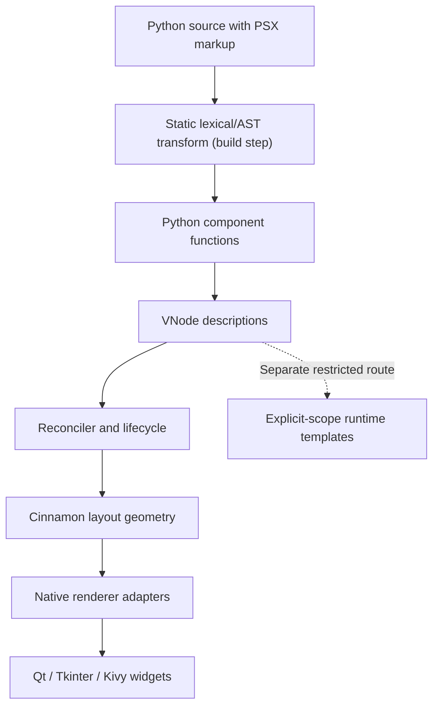

# How Velto works

Velto separates **how Python-authored markup becomes an interface description** from **how that description is mounted into native widgets**.

**Diagram in words:** developer-authored PSX is statically transformed before execution; component functions produce VNodes; the runtime reconciles them; Cinnamon computes geometry; native adapters apply the result to real widgets. The dashed path indicates that restricted runtime templates are a separate processing mode, not an arbitrary Python evaluator.

## Two markup paths

Static PSX authored in Python follows the lexical/AST transformation contract. Restricted runtime templates have a separate, constrained interpretation path. Neither path should be documented as granting arbitrary `eval`, `exec` or frame-based lookup.

Use quoted literals for static attributes, such as `gap="12"`. Curly braces are reserved for supported references and expressions, not arbitrary constant wrappers.

## A native application is not a web page

The selected backend creates real widgets. There is no Chromium, DOM or browser intermediary. Window configuration belongs to application settings rather than a `<Window>` markup element.

## What this diagram does not guarantee

A backend being listed does not establish support for a particular component, property, Python version or operating system. Compatibility claims will be linked to test receipts in the component and application reference pages.

See [Core concepts](/concepts/overview) or return to [Introduction](/introduction).
