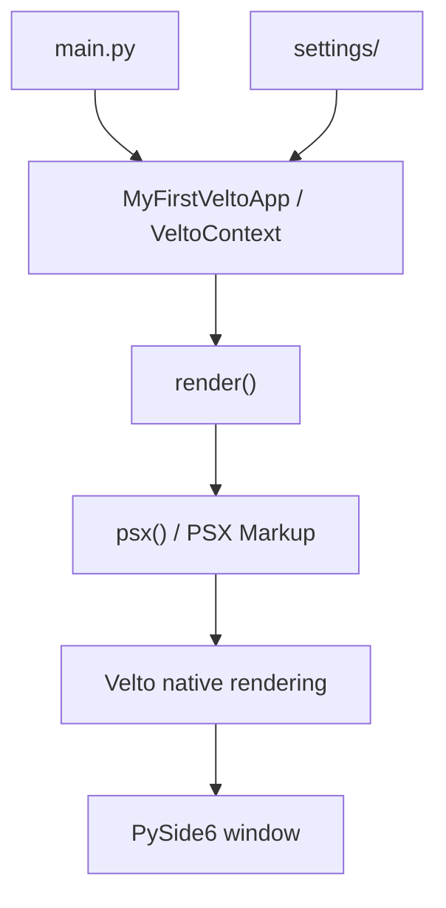

You've installed Velto CLI and initialized a PySide6 project. Now you'll explore the generated files, understand the entry point, and launch a native window displaying **Hello, World!**

## 1. Open the generated project

Complete [Install Velto](/getting-started/installation) first. With the virtual environment activated, enter your application directory if you have not already:

```bash
cd my-first-velto-app
```

The project template has a structure like this (the icon files are included with the template):

```text
my-first-velto-app/
├── components/
│   └── .gitkeep
├── resources/
│   ├── base/
│   │   └── icons/
│   │       ├── 16.png
│   │       ├── 24.png
│   │       ├── 32.png
│   │       ├── 64.png
│   │       ├── Icon.ico
│   │       ├── install.ico
│   │       └── uninstall.ico
│   ├── linux/
│   │   └── icons/
│   │       ├── 1024.png
│   │       ├── 128.png
│   │       ├── 256.png
│   │       └── 512.png
│   └── mac/
│       ├── icons/
│       │   ├── 1024.png
│       │   ├── 128.png
│       │   ├── 256.png
│       │   ├── 32.png
│       │   ├── 512.png
│       │   └── 64.png
│       └── release/
│           └── dmg-background.png
├── settings/
│   ├── base.json
│   ├── linux.json
│   ├── mac.json
│   ├── release.json
│   ├── secrets.json
│   ├── sign.json
│   └── windows.json
├── views/
│   └── .gitkeep
├── .gitignore
├── LICENSE
├── README.md
├── main.py
└── pyproject.toml
```

| Path | Purpose |
| --- | --- |
| `main.py` | Application entry point and first interface |
| `components/` | Reusable interface components |
| `views/` | Application views and screens |
| `resources/` | Icons and platform-specific assets |
| `settings/` | Base, platform, release, and signing configuration |
| `pyproject.toml` | Python project metadata and dependencies |

<Note>
  `.gitkeep` files allow initially empty folders to be tracked by Git. You do not need to edit the resource or release files for this first application.
</Note>

## 2. Meet your first application

Open **`main.py`** in your editor. The generated entry point follows this pattern:

```python
import sys
from qyro import VeltoContext
from psx import psx

class MyFirstVeltoApp(VeltoContext):
    def render(self):
        return psx("""
            <Flex>
                <Text>Hello, World!</Text>
            </Flex>
        """)

if __name__ == "__main__":
    sys.exit(MyFirstVeltoApp().run())
```

This is a complete Python entry point, not an HTML document.

### `VeltoContext` manages the application

```python
from qyro import VeltoContext

class MyFirstVeltoApp(VeltoContext):
    ...
```

`VeltoContext` integrates your Velto interface with the Qyro application runtime. Your subclass defines the application-specific UI through `render()`.

### `render()` describes what appears

```python
def render(self):
    return psx("""
        <Flex>
            <Text>Hello, World!</Text>
        </Flex>
    """)
```

The `render()` method returns a PSX interface description. `Flex` is the layout container and `Text` displays the greeting. PSX Markup resembles HTML or JSX, but its elements are rendered through the selected native UI backend, not a browser.

### `run()` starts the application

```python
if __name__ == "__main__":
    sys.exit(MyFirstVeltoApp().run())
```

The `__main__` guard ensures this entry point runs when you execute the file directly. `run()` starts the application lifecycle, and `sys.exit()` forwards its exit status to the operating system.

## 3. Understand where the window is configured

You won't find a `<Window>` tag in PSX Markup. Window properties such as its title and size belong to the project's **`settings/`** configuration, not to the component tree.

Start by inspecting `settings/base.json`, then the configuration for your operating system. Do not change signing or release settings for this tutorial.

## 4. Install project dependencies

The CLI and your application are separate concerns: the CLI initializes the template, while the application uses the packages declared by that template.

With your environment active and your terminal inside the generated project, inspect `README.md` and `pyproject.toml` for the template's dependency installation instructions. Follow those instructions before running the entry point.

<Note>
  This section requires confirmation of the exact dependency-install command from the released PySide6 template. The CLI's template download alone should not be taken as proof that all runtime dependencies have been installed.
</Note>

## 5. Run your first native application

From the project directory, with its dependencies installed and a graphical desktop session available, run:

```bash
python main.py
```

The expected result is a **native application window** containing:

```text
Hello, World!
```

Close the window using your operating system's normal window controls.

<Note>
  This is the direct Python entry-point command for the shown `main.py`. The released template's recommended CLI launch command, if different, must be confirmed before certification.
</Note>

## 6. Make your first change

Open `main.py` and change the text inside the `Text` element:

```python
def render(self):
    return psx("""
        <Flex>
            <Text>My first Velto application!</Text>
        </Flex>
    """)
```

This is a fragment of the same `MyFirstVeltoApp` class, not a second standalone program.

Save the file, close the running application if necessary, and run it again:

```bash
python main.py
```

Your window should now display **My first Velto application!**

You have completed the essential development cycle: edit PSX Markup, launch the Python application, and observe the result in a native window.

## 7. How the pieces fit together



The Python entry point controls startup, `render()` provides the component tree, and the native renderer displays the interface. Settings configure application and window behavior separately.

## Troubleshooting

**`ModuleNotFoundError: qyro` or `psx`:** verify that the generated project's dependencies are installed in the active virtual environment.

**No window appears:** make sure you're running in a graphical desktop session rather than a headless terminal.

**Qt platform plugin error on Linux:** check your display server and the system libraries required by the selected Qt binding.

**Changes don't appear:** save `main.py`, close the old process, and run the entry point again. This tutorial does not assume hot reloading.

## What's next?

You have initialized a project, explored its structure, understood the application entry point, and launched your first native interface.

Next: [**Learn PSX Markup →**](/learn/psx-markup).
