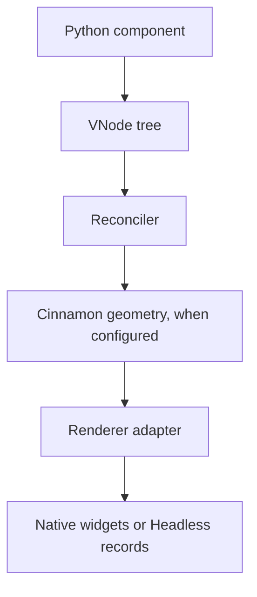

# How a Velto app runs

A **VNode** is a description of the desired UI, not a desktop control. When `App.mount()` runs, the reconciler creates mounted instances and delegates widget creation to the selected renderer. With Headless, the handles are in-memory records; with a supported native backend, the renderer creates actual toolkit widgets.

**Diagram alternative:** Python components create VNodes; reconciliation produces mounted instances; layout geometry, when enabled, is computed by Cinnamon; the selected renderer commits widget operations. Static PSX source transformation happens before Python execution and is a separate stage. Read [architecture](/concepts/architecture) for the distinction.

A `Fragment` does not automatically provide Flex geometry. Use [your first app](/getting-started/first-app) to inspect a real Headless handle.

## Verify and continue

After following [installation](/getting-started/installation), run `cd examples/f5_5_beginner && python -m unittest -v test_examples` to exercise the two complete Headless project examples. It does **not** certify each illustrative fragment or a native backend. For observable output and troubleshooting, refer to [first app](/getting-started/first-app). Source baseline: `develop` at `cfbb93cd6a5990bc5ad38df82b28205270ae060f`; new lessons require CI verification on the PR head.
