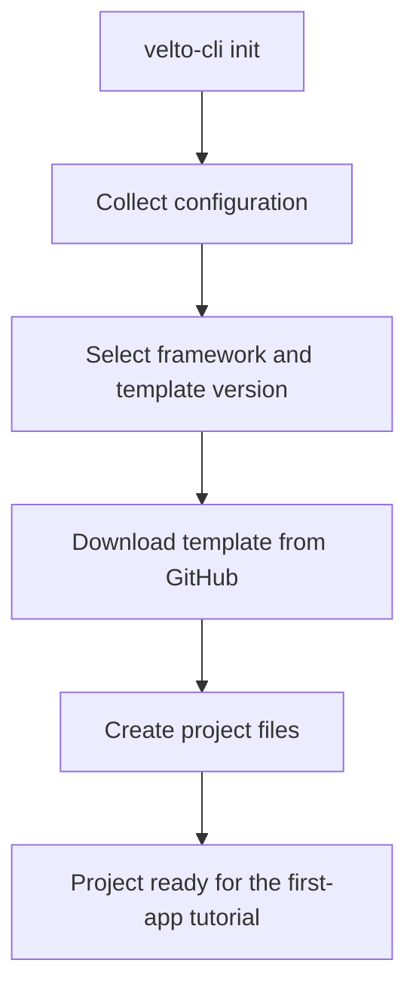

You'll install Velto and **PySide6**, the Qt binding used in our first tutorial. By the end, your computer will be ready to open a native desktop window.

## Before you begin

You'll need **Python 3.10–3.13**, Git, a terminal, and a graphical desktop session on Windows, macOS, or Linux. The commands below install the current project source so they match the examples in this documentation.

## 1. Create a virtual environment

Create a workspace for your first application:

```bash
mkdir my-velto-projects
cd my-velto-projects
python -m venv .venv
```

Activate the environment on **macOS or Linux**:

```bash
source .venv/bin/activate
```

On **Windows PowerShell**:

```powershell
.venv\Scripts\Activate.ps1
```

On **Windows Command Prompt**:

```bat
.venv\Scripts\activate.bat
```

A virtual environment isolates Python packages from other projects. Keep it activated for the following steps.

## 2. Install Velto CLI

Install the project initialization tool inside the active environment:

```bash
python -m pip install velto-cli
```

Check that its command is available:

```bash
velto-cli --help
```

<Note>
  The CLI is a project creation tool. The generated Python application uses `qyro.VeltoContext` and the current `psx` import namespace.
</Note>

## 3. Initialize your first project

For this tutorial, select **PySide6** (Qt 6):

```bash
velto-cli init --name my-first-velto-app --framework pyside6
```

The CLI may open an interactive **Initialize a project** form for any remaining configuration. Follow its prompts.

You can also start with only a framework:

```bash
velto-cli init --framework pyside6
```

Or select a template version explicitly:

```bash
velto-cli init \
  --name my-first-velto-app \
  --framework pyside6 \
  --template-version 1.0.x
```

- `--name` names the new project.
- `--framework` selects its native UI binding.
- `--template-version` selects the requested template release series.

Velto CLI downloads the selected project template from **GitHub**. The template provides your application entry point, settings, resources, and project metadata.

<Note>
  The commands above are alternative ways to initialize a project, not consecutive steps. Run one of them in an empty destination.
</Note>

## 4. Other supported UI frameworks

| Framework | Native toolkit |
| --- | --- |
| `pyside6` | Qt 6 via PySide6 |
| `pyqt6` | Qt 6 via PyQt6 |
| `pyqt5` | Qt 5 via PyQt5 |
| `pyside2` | Qt 5 via PySide2 |
| `tkinter` | Python's Tk toolkit |
| `kivy` | Kivy |

The rest of Getting Started uses **PySide6**. Backend support and Python compatibility can differ, so choose a binding compatible with your environment.

## 5. Non-interactive initialization

When writing scripts or preparing repeatable project setups, provide the configuration directly and add `--yes`:

```bash
velto-cli init \
  --name my-first-velto-app \
  --target-platform desktop \
  --framework pyside6 \
  --app-name "My First Velto App" \
  --version 1.0.0 \
  --author "Your Name" \
  --addon pydux \
  --addon requests \
  --yes
```

| Option | Meaning |
| --- | --- |
| `--target-platform` | Target platform, here `desktop` |
| `--app-name` | Human-readable application name |
| `--version` | Initial application version |
| `--author` | Author metadata |
| `--addon` | Optional Python library to include in the project |
| `--yes` | Non-interactive initialization |

**Addons** extend your application's functionality. For example, `pydux` provides state-management utilities and `requests` is an HTTP client. Repeat `--addon` to request multiple libraries. Addons do not replace your selected UI framework.

## 6. What happens during initialization?



The CLI creates a project based on the chosen template; it does not require you to clone the Velto framework source repository manually.

## 7. Open your project

After initialization succeeds, enter the generated directory:

```bash
cd my-first-velto-app
```

You should find `main.py`, `pyproject.toml`, and directories for components, views, resources, and settings. The next page shows how these pieces fit together and how to start your native application.

## Troubleshooting

**Python is not recognized:** verify the Python installation. Depending on your system, use `python3` or the Windows `py` launcher.

**The environment does not activate:** check the shell-specific command. PowerShell execution policy may prevent script activation.

**`velto-cli` is not recognized:** reactivate the environment and check `python -m pip show velto-cli`.

**The template cannot be downloaded:** check Internet access, GitHub connectivity, and the requested template version.

**Project creation fails:** verify that the destination is suitable for initialization and that your Python version supports the chosen framework.

Next: [**Run your first native Velto application →**](/getting-started/first-app).
