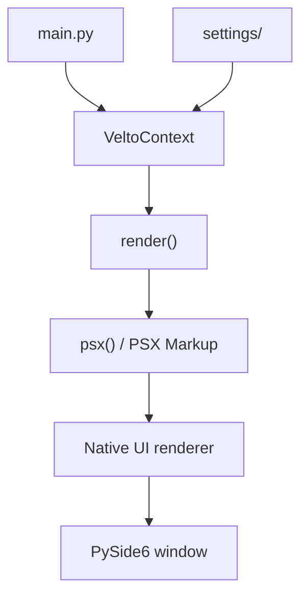

In a few minutes, you'll create your first **native desktop window** with Velto. You'll install the framework, write a small PSX Markup interface and open a real native window. Everything you need is on this page.

We'll use **PySide6 (Qt 6)** for the first example. Velto also integrates with PyQt6, PyQt5, PySide2, Tkinter and Kivy.

## 1. Prepare Python

You'll need **Python 3.10–3.13**, a terminal, an Internet connection and a graphical desktop session on Windows, macOS or Linux.

Create a workspace and an isolated Python environment:

```bash
mkdir my-velto-projects
cd my-velto-projects
python -m venv .venv
```

Activate it on **macOS or Linux**:

```bash
source .venv/bin/activate
```

On **Windows PowerShell**:

```powershell
.venv\Scripts\Activate.ps1
```

Or on **Windows Command Prompt**:

```bat
.venv\Scripts\activate.bat
```

The virtual environment keeps this project's Python dependencies isolated. Keep it active throughout the tutorial.

## 2. Install Velto CLI

Install the tool that creates Velto applications:

```bash
python -m pip install velto-cli
```

Check that it is available:

```bash
velto-cli --help
```

<Note>
  Velto CLI creates the project from a template hosted on GitHub. You do not need to clone the Velto framework source to follow this tutorial. The generated application's imports currently use `qyro` and `psx`.
</Note>

## 3. Create your first project

Initialize a project using the **PySide6** native UI backend:

```bash
velto-cli init --name my-first-velto-app --framework pyside6
```

The CLI may present an interactive form for remaining project settings. Complete its prompts to create the project.

Alternatively, you can start the interactive flow with:

```bash
velto-cli init --framework pyside6
```

To request a particular template version series:

```bash
velto-cli init \
  --name my-first-velto-app \
  --framework pyside6 \
  --template-version 1.0.x
```

These are **alternatives**, not commands to run one after another. Use one initialization command for your new project.

### Other supported frameworks

| Framework | UI toolkit |
| --- | --- |
| `pyside6` | Qt 6 (PySide6) |
| `pyqt6` | Qt 6 (PyQt6) |
| `pyqt5` | Qt 5 (PyQt5) |
| `pyside2` | Qt 5 (PySide2) |
| `tkinter` | Tk |
| `kivy` | Kivy |

This tutorial continues with PySide6. Compatibility depends on the selected backend and Python version.

### Optional: non-interactive setup

For automated setup, the CLI also accepts explicit metadata and optional libraries:

```bash
velto-cli init \
  --name my-first-velto-app \
  --target-platform desktop \
  --framework pyside6 \
  --app-name "My First Velto App" \
  --version 1.0.0 \
  --author "Your Name" \
  --addon pydux \
  --addon requests \
  --yes
```

Here `--yes` requests non-interactive initialization. The repeatable `--addon` option requests extra Python libraries, such as Pydux for state management or Requests for HTTP communication. Addons are optional for Hello World.

## 4. Explore the generated project

Enter the generated directory:

```bash
cd my-first-velto-app
```

The template creates an application with a structure like this:

```text
my-first-velto-app/
├── components/
│   └── .gitkeep
├── resources/
│   ├── base/
│   │   └── icons/
│   │       ├── 16.png
│   │       ├── 24.png
│   │       ├── 32.png
│   │       ├── 64.png
│   │       ├── Icon.ico
│   │       ├── install.ico
│   │       └── uninstall.ico
│   ├── linux/
│   │   └── icons/
│   │       ├── 1024.png
│   │       ├── 128.png
│   │       ├── 256.png
│   │       └── 512.png
│   └── mac/
│       ├── icons/
│       │   ├── 1024.png
│       │   ├── 128.png
│       │   ├── 256.png
│       │   ├── 32.png
│       │   ├── 512.png
│       │   └── 64.png
│       └── release/
│           └── dmg-background.png
├── settings/
│   ├── base.json
│   ├── linux.json
│   ├── mac.json
│   ├── release.json
│   ├── secrets.json
│   ├── sign.json
│   └── windows.json
├── views/
│   └── .gitkeep
├── .gitignore
├── LICENSE
├── README.md
├── main.py
└── pyproject.toml
```

You don't need to understand every file before starting. Focus on these:

| Path | What it does |
| --- | --- |
| `main.py` | Defines and starts your application |
| `components/` | Holds reusable UI components |
| `views/` | Holds application screens |
| `resources/` | Contains images and platform-specific assets |
| `settings/` | Holds application, window, platform and release configuration |
| `pyproject.toml` | Describes your Python project and its dependencies |

<Note>
  Velto does not use a `<Window>` PSX element. Window configuration belongs to `settings/`, separately from the interface described in markup.
</Note>

## 5. Understand the generated application

Open `main.py`. The PySide6 template's starter application follows this pattern:

```python
import sys
from qyro import VeltoContext
from psx import psx

class MyFirstVeltoApp(VeltoContext):
    def render(self):
        return psx("""
            <Flex>
                <Text>Hello, World!</Text>
            </Flex>
        """)

if __name__ == "__main__":
    sys.exit(MyFirstVeltoApp().run())
```

Let's understand each part before running it.

### `VeltoContext`: your application context

`MyFirstVeltoApp` extends `VeltoContext`, which integrates the Velto interface with the Qyro application runtime.

### `render()`: your interface definition

`render()` returns the application's interface. The `psx()` function accepts **PSX Markup**, a declarative syntax that looks familiar if you've seen HTML or JSX.

Inside the markup:

- `<Flex>` is the layout container.
- `<Text>` displays the greeting.
- `Hello, World!` is the text you will see in the window.

This is **native UI**, not a web page embedded in a browser.

### `run()`: starting the application

The `if __name__ == "__main__":` guard makes the file executable as a Python program. `MyFirstVeltoApp().run()` starts the application lifecycle; `sys.exit()` passes the exit status back to the operating system.

## 6. Install dependencies and launch the app

The CLI installs or creates the project template; the application also needs its declared runtime dependencies. Check the generated `README.md` and `pyproject.toml` for the template-specific installation instructions, and complete them in your active virtual environment.

<Note>
  The precise installation command for the released PySide6 template still requires verification against that template. This page does not assume that downloading a template automatically installs every runtime dependency.
</Note>

Once the project's dependencies are available, run the entry point from the generated project directory:

```bash
python main.py
```

You should see a **native desktop window** displaying:

```text
Hello, World!
```

Close the window using your operating system's normal close control.

## 7. Make your first change

In `main.py`, change the `Text` element inside `render()`:

```python
def render(self):
    return psx("""
        <Flex>
            <Text>My first Velto application!</Text>
        </Flex>
    """)
```

This is a fragment of the existing class, not a separate standalone application.

Save the file and start it again:

```bash
python main.py
```

The window should now display **My first Velto application!**

You've completed your first development loop: **edit markup → run Python → see a native interface**.

## 8. How Velto works



Your Python application defines the UI through `render()`; Velto renders its components through the chosen native toolkit. Settings describe application and window configuration separately.

## Troubleshooting

**Python or pip isn't recognized:** verify Python installation and use `python3` or the Windows `py` launcher if necessary.

**`velto-cli` isn't recognized:** activate the virtual environment and check `python -m pip show velto-cli`.

**Template download fails:** verify Internet access, GitHub availability and any requested template version.

**`ModuleNotFoundError: qyro` or `psx`:** install the generated project's dependencies in the active virtual environment.

**No window appears:** run in a graphical desktop session. Qt cannot display a window in a headless terminal without appropriate display infrastructure.

**Your text didn't change:** save `main.py`, close the previous process, and run the app again. Hot reloading is not assumed here.

## What's next?

You now have a generated project and a native Hello World application. Continue with [Install Velto](/getting-started/installation) for CLI options, [Your first application](/getting-started/first-app) for a more detailed walkthrough, or [PSX Markup](/learn/psx-markup) to learn how to build richer interfaces.
